#  SmartClosetAI — Armario Inteligente y Estilista Personal con IA en SQL Server 2025

> **Proyecto Final — Certificación Microsoft DP-800**  
> Diseño relacional avanzado, seguridad corporativa Multi-Tenant (RLS & DDM), vectores nativos (`VECTOR(768)`), búsqueda inteligente híbrida (RRF), arquitectura RAG 100% local con Ollama y aplicación web Full-Stack en Python (FastAPI + Streamlit).

---

##  Índice de Contenidos

1. [Descripción del Proyecto](#-1-descripción-del-proyecto)
2. [Arquitectura de la Solución](#-2-arquitectura-de-la-solución)
3. [Tecnologías Utilizadas](#-3-tecnologías-utilizadas)
4. [Estructura del Repositorio](#-4-estructura-del-repositorio)
5. [Guía de Instalación y Reproducción desde Cero](#-5-guía-de-instalación-y-reproducción-desde-cero)
6. [Evolución y Diseño de la Base de Datos](#-6-evolución-y-diseño-de-la-base-de-datos)
7. [Funcionalidades DP-800 Implementadas (Bloques A - G)](#-7-funcionalidades-dp-800-implementadas-bloques-a---g)
8. [Ejemplos de Consultas SQL: Intelligent Search, RAG y Seguridad](#-8-ejemplos-de-consultas-sql-intelligent-search-rag-y-seguridad)
9. [Demostración de la Aplicación Web (FastAPI + Streamlit)](#-9-demostración-de-la-aplicación-web-fastapi--streamlit)
10. [Batería de Pruebas Automatizadas (Testing)](#-10-batería-de-pruebas-automatizadas-testing)
11. [Conclusiones](#-11-conclusiones)

---

##  1. Descripción del Proyecto

**SmartClosetAI** es una solución integral de base de datos inteligente construida sobre **SQL Server 2025** que resuelve un problema cotidiano mediante Inteligencia Artificial Generativa y búsqueda vectorial: **la gestión inteligente de un armario personal y la recomendación de vestimenta contextualizada**.

Cuando un usuario le pregunta a un modelo de lenguaje tradicional (como ChatGPT) *"¿Qué me pongo hoy para una boda en el campo con mucho calor?"*, el modelo responde con sugerencias genéricas de moda o inventa prendas (alucinaciones) que el usuario no posee. **SmartClosetAI** transforma la base de datos en un estilista personal privado que:

1. **Conoce el inventario real y el estado de cada prenda** (si está limpia o sucia, su tejido, formalidad, impermeabilidad y temporada).
2. **Aprende de las experiencias previas** (lee las notas de los *outfits* y los comentarios de valoraciones pasadas, como *"pasé mucho calor"* o *"los zapatos me hicieron daño al caminar"*).
3. **Aísla estrictamente la privacidad de cada usuario** mediante políticas de seguridad a nivel de fila (*Row-Level Security*), garantizando que el motor vectorial y el LLM solo consulten el armario de la persona que pregunta.
4. **Ejecuta toda la Inteligencia Artificial en local (100% On-Premise)** utilizando **Ollama**, sin enviar datos personales a la nube ni depender de claves de API de pago.

---

##  2. Arquitectura de la Solución

La arquitectura del proyecto integra cuatro capas desacopladas que se comunican de forma segura dentro de la máquina local:

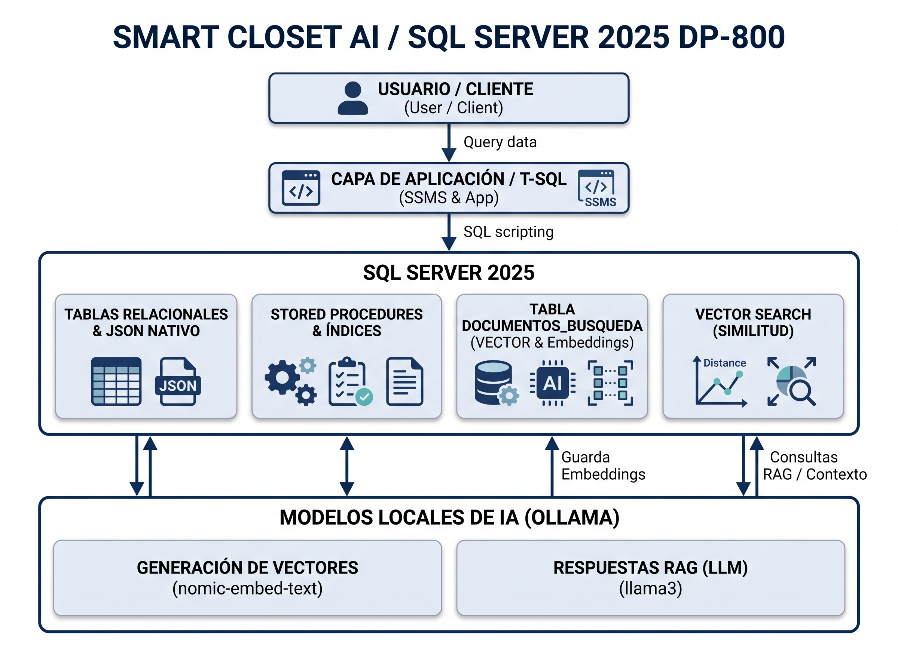

### Flujo de Datos Extremo a Extremo
$$\text{Usuario (Streamlit)} \rightarrow \text{API Backend (FastAPI)} \rightarrow \text{SQL Server 2025 (RLS + Vector Search)} \rightarrow \text{Proxy TLS (Caddy)} \rightarrow \text{IA Local (Ollama)}$$

1. **Capa de Presentación y Aplicación (`app/`):**
   * **Frontend (Streamlit):** Interfaz conversacional tipo chat donde el usuario selecciona su perfil (Lucía, Carlos, Elena o Mateo) y escribe su consulta en lenguaje natural.
   * **Backend (FastAPI + `pyodbc`):** Recibe la petición HTTP y ejecuta el procedimiento almacenado `dbo.usp_ConsultarEstilistaRAG` en SQL Server.
2. **Núcleo de Base de Datos (`SQL Server 2025`):**
   * **Seguridad (`sec`):** Aplica el contexto de sesión (`SESSION_CONTEXT`) para activar *Row-Level Security (RLS)* y enmascaramiento dinámico (*DDM*).
   * **Motor Relacional y JSON Nativo:** Almacena las tablas normalizadas y metadatos flexibles con el tipo de dato nativo `JSON`.
   * **Motor Vectorial (`DOCUMENTOS_BUSQUEDA`):** Almacena fragmentos de texto enriquecidos (*chunks*) junto con su representación matemática en columnas `VECTOR(768)` y calcula la similitud semántica mediante `VECTOR_DISTANCE('cosine', ...)`.
3. **Puente de Seguridad TLS (`Caddy Reverse Proxy`):**
   * SQL Server 2025 exige por diseño que todas las invocaciones a modelos externos (`CREATE EXTERNAL MODEL` y `sp_invoke_external_rest_endpoint`) viajen cifradas mediante **HTTPS/TLS** con un certificado válido en el almacén de la máquina. Caddy actúa como proxy inverso local recibiendo peticiones en `https://localhost:11435` y redirigiéndolas a Ollama en `http://127.0.0.1:11434`.
4. **Motor de Inferencia de IA Local (`Ollama`):**
   * **Modelo de Embeddings (`nomic-embed-text`):** Convierte las descripciones del armario y las preguntas del usuario en vectores densos de $768$ dimensiones.
   * **Modelo Generativo LLM (`llama3.2:3b`):** Recibe los documentos recuperados por SQL Server bajo una instrucción estricta de *Grounding* y redacta la recomendación estilística final.

---

## 🛠️ 3. Tecnologías Utilizadas

| Componente | Tecnología / Herramienta | Propósito en el Proyecto |
| :--- | :--- | :--- |
| **Motor de Base de Datos** | **Microsoft SQL Server 2025** | Almacenamiento relacional, tipos nativos `JSON` y `VECTOR(768)`, funciones regex/fuzzy, seguridad RLS/DDM e invocación REST nativa. |
| **Entorno de Gestión SQL** | **SSMS 21 / VS Code** | Desarrollo, depuración y ejecución de scripts T-SQL y pruebas de rendimiento. |
| **Servidor de IA Local** | **Ollama** | Ejecución local de modelos de lenguaje y embeddings sin dependencia de la nube. |
| **Modelo de Embeddings** | **`nomic-embed-text`** | Generación de vectores semánticos de $768$ dimensiones mediante `AI_GENERATE_EMBEDDINGS`. |
| **Modelo Generativo (LLM)** | **`llama3.2:3b`** | Generación de respuestas contextualizadas en español para el pipeline RAG. |
| **Proxy Inverso TLS** | **Caddy Server** | Exposición de la API de Ollama sobre HTTPS (`11435`) con certificado raíz local confiable para SQL Server. |
| **Backend API** | **Python 3 + FastAPI + `pyodbc`** | Pasarela REST ligera que conecta la interfaz web con el procedimiento almacenado RAG de SQL Server. |
| **Frontend Web** | **Streamlit** | Interfaz gráfica interactiva de chat con selector de usuario y visor de contexto (*Grounding*). |

---

## 📂 4. Estructura del Repositorio

El repositorio está organizado de forma modular y secuencial para facilitar su auditoría y despliegue paso a paso:

```text
dp800-smart-closet/
│
├── README.md                          # Documentación principal y guía de reproducción
├── .gitignore                         # Exclusión de entornos virtuales (venv) y archivos temporales
│
├── database/                          # Scripts T-SQL del motor relacional, programabilidad y seguridad
│   ├── 01_create_database.sql         # Creación de la BD SmartClosetAI y activación de PREVIEW_FEATURES
│   ├── 02_create_tables.sql           # Tablas relacionales, constraints, JSON nativo y tabla DOCUMENTOS_BUSQUEDA
│   ├── 03_insert_data.sql             # Carga de datos (4 usuarios, 26 prendas, outfits, valoraciones y 50 chunks)
│   ├── 04_views.sql                   # Vistas analíticas con JSON_VALUE, CTEs y Window Functions
│   ├── 05_procedures.sql              # Funciones Fuzzy/Regex, Trigger incremental de IA y SPs transaccionales
│   ├── 06_security.sql                # Usuarios WITHOUT LOGIN, Roles, GRANT/DENY/REVOKE, DDM y RLS Multi-Tenant
│   └── 07_indexes.sql                 # Índices Nonclustered de cobertura (INCLUDE) y análisis de planes de ejecución
│
├── ai/                                # Scripts T-SQL de Inteligencia Artificial (Bloques E, F y G)
│   ├── 01_create_external_model.sql   # Habilitación de REST endpoint y registro de ModeloEmbeddingsOllama
│   ├── 02_generate_embeddings.sql     # Generación y mantenimiento incremental de vectores VECTOR(768)
│   ├── 03_vector_search.sql           # Búsqueda Vectorial (Coseno), Búsqueda Léxica e Híbrida (RRF)
│   └── 04_rag.sql                     # Procedimiento almacenado RAG (usp_ConsultarEstilistaRAG) con Llama 3.2
│
├── app/                               # Aplicación Web Full-Stack en Python
│   ├── requirements.txt               # Dependencias de Python (fastapi, uvicorn, streamlit, pyodbc)
│   ├── api.py                         # Backend FastAPI conectado a SQL Server 2025
│   └── chat.py                        # Frontend interactivo en Streamlit con selector de usuario RLS
│
├── tests/                             # Validación y aseguramiento de calidad
│   └── tests.sql                      # Script automatizado de pruebas (PASS/FAIL) de todos los bloques
│
├── docs/                              # Documentación técnica detallada y modelo inicial
│   ├── InitialDatabase/               # Scripts y documentación del modelo relacional inicial (SmartCloset)
│   ├── arquitectura.png               # Diagrama de arquitectura del sistema
│   ├── proyecto.md                    # Memoria técnica completa en formato Markdown
│   └── proyecto.pdf                   # Memoria técnica exportada a PDF
│
├── media/                             # Capturas de pantalla de evidencias y demostraciones
│   └── 01_Initial_db_comprobation.png # Evidencia de despliegue de la base de datos inicial
│
└── presentation/                      # Material de defensa del proyecto
    └── dp800-project.pptx             # Presentación ejecutiva del proyecto
```

---

## 🚀 5. Guía de Instalación y Reproducción desde Cero

Esta guía está diseñada para que cualquier persona pueda reproducir el proyecto completo desde cero en su máquina local con **Windows 11**, sin necesidad de conocer el código internamente.

### Paso 1: Prerrequisitos del Sistema
Asegúrate de tener instalados los siguientes componentes:
1. **SQL Server 2025 (Developer o Express Edition)** con la instancia local predeterminada (`localhost` / `MSSQLSERVER`) y **SQL Server Management Studio (SSMS 21+)**.
2. **ODBC Driver 17 for SQL Server** (incluido habitualmente con SSMS).
3. **Ollama** para Windows ([Descargar aquí](https://ollama.com/)).
4. **Caddy Server** ([Descargar aquí](https://caddyserver.com/download) o instalar vía `winget install CaddyServer.Caddy`).
5. **Python 3.10 o superior** ([Descargar aquí](https://www.python.org/)).

---

### Paso 2: Preparar los Modelos Locales en Ollama
Abre una terminal de **PowerShell** y descarga los dos modelos ligeros utilizados en el proyecto (el modelo de embeddings y el LLM generativo):

```powershell
# 1. Descargar el modelo de embeddings (768 dimensiones, ~274 MB)
ollama pull nomic-embed-text

# 2. Descargar el modelo generativo Llama 3.2 de 3B parámetros (~2.0 GB)
ollama pull llama3.2:3b
```
Verifica que Ollama esté corriendo en segundo plano en el puerto `11434` (puedes comprobarlo abriendo `http://127.0.0.1:11434` en tu navegador, donde verás el mensaje *"Ollama is running"*).

---

### Paso 3: Configurar el Puente HTTPS con Caddy para SQL Server 2025
SQL Server 2025 requiere obligatoriamente endpoints **HTTPS** con certificados confiables para ejecutar `CREATE EXTERNAL MODEL` y `sp_invoke_external_rest_endpoint`.

1. Abre una ventana de **PowerShell como Administrador** y levanta el proxy inverso de Caddy del puerto `11435` (HTTPS) al `11434` (HTTP de Ollama):
   ```powershell
   caddy reverse-proxy --from https://localhost:11435 --to http://127.0.0.1:11434
   ```
   *(Deja esta terminal abierta mientras utilices el proyecto).*

2. **Importar el certificado raíz de Caddy en Windows (Solo la primera vez):**  
   Para que el servicio de SQL Server confíe en el certificado autofirmado de Caddy, abre otra terminal de **PowerShell como Administrador** y ejecuta:
   ```powershell
   # Generar e instalar el certificado de confianza de Caddy
   caddy trust

   # Importar explícitamente el certificado raíz en el almacén de la Máquina Local (LocalMachine\Root)
   Import-Certificate -FilePath "$env:APPDATA\Caddy\pki\authorities\local\root.crt" -CertStoreLocation Cert:\LocalMachine\Root

   # Reiniciar el servicio de SQL Server para que recargue los certificados del sistema
   Restart-Service -Name MSSQLSERVER -Force
   ```

---

### Paso 4: Desplegar la Base de Datos y el Motor de IA en SSMS
Abre **SQL Server Management Studio (SSMS)**, conéctate a tu servidor `localhost` y abre y ejecuta los scripts del repositorio **exactamente en este orden**:

1. **Bloque Base de Datos (`database/`):**
   * `database/01_create_database.sql` $\rightarrow$ Crea la base de datos `SmartClosetAI` y activa `PREVIEW_FEATURES = ON`.
   * `database/02_create_tables.sql` $\rightarrow$ Crea las 7 tablas del negocio + la tabla `DOCUMENTOS_BUSQUEDA` con `VECTOR(768)` y columnas `JSON`.
   * `database/03_insert_data.sql` $\rightarrow$ Inserta los 4 usuarios, marcas, ocasiones, 26 prendas, outfits, valoraciones y puebla los 50 fragmentos de texto (*chunks*).
   * `database/04_views.sql` $\rightarrow$ Crea las vistas analíticas y de extracción JSON.
   * `database/05_procedures.sql` $\rightarrow$ Crea la función de búsqueda difusa, el trigger de sincronización de *chunks* y los procedimientos transaccionales.
   * `database/06_security.sql` $\rightarrow$ Configura los roles, usuarios sin login, permisos, máscaras DDM y políticas RLS.
   * `database/07_indexes.sql` $\rightarrow$ Crea los índices Nonclustered de alto rendimiento.

2. **Bloque Inteligencia Artificial (`ai/`):**
   * `ai/01_create_external_model.sql` $\rightarrow$ Habilita las llamadas REST salientes y registra el objeto `ModeloEmbeddingsOllama`.
   * `ai/02_generate_embeddings.sql` $\rightarrow$ Conecta con Ollama y genera automáticamente los 50 vectores de $768$ dimensiones en `DOCUMENTOS_BUSQUEDA`.
   * `ai/03_vector_search.sql` $\rightarrow$ Ejecuta las pruebas de búsqueda semántica vectorial, búsqueda léxica y búsqueda híbrida con RRF.
   * `ai/04_rag.sql` $\rightarrow$ Crea el procedimiento almacenado `dbo.usp_ConsultarEstilistaRAG` y lanza una prueba contra Llama 3.2.

3. **Verificación de Calidad (`tests/`):**
   * `tests/tests.sql` $\rightarrow$ Ejecuta la suite completa de validación y comprueba que todos los controles devuelven **`PASS`**.

---

### Paso 5: Poner en Marcha la Aplicación Web en Python (`app/`)
Una vez lista la base de datos, puedes levantar la interfaz gráfica web en menos de dos minutos:

1. Abre una terminal de **PowerShell**, entra en la carpeta `app/` del repositorio y crea el entorno virtual:
   ```powershell
   cd app
   python -m venv venv
   .\venv\Scripts\Activate.ps1
   pip install -r requirements.txt
   ```
   *(Si PowerShell bloquea la activación del script, ejecuta antes: `Set-ExecutionPolicy Unrestricted -Scope CurrentUser`).*

2. **Arrancar el Backend (FastAPI):** En esa misma terminal con `(venv)` activado, ejecuta:
   ```powershell
   uvicorn api:app --reload
   ```
   El servidor API quedará escuchando en `http://127.0.0.1:8000`.

3. **Arrancar el Frontend (Streamlit):** Abre **una segunda pestaña de PowerShell**, sitúate en `app/`, activa el entorno virtual y lanza la interfaz web:
   ```powershell
   cd app
   .\venv\Scripts\Activate.ps1
   streamlit run chat.py
   ```
   Se abrirá automáticamente tu navegador en `http://localhost:8501` con el chat del Estilista Inteligente listo para usar.

---

## 🗄️ 6. Evolución y Diseño de la Base de Datos

### 6.1. De `SmartCloset` (Modelo Origen) a `SmartClosetAI`
El proyecto partió de un modelo relacional clásico (`SmartCloset`, documentado en `docs/InitialDatabase/`) diseñado para gestionar el inventario de ropa de múltiples usuarios utilizando claves primarias explícitas (sin `IDENTITY`) para garantizar el control determinista de los identificadores en los scripts de carga.

```text
┌──────────────────┐       1        N ┌──────────────────┐
│     USUARIOS     │─────────────────│      OUTFITS     │
└──────────────────┘                 └────────┬─────────┘
                                               │ 1
                                               │
                                               │ N
                                      ┌────────┴─────────┐
                                      │  OUTFIT_PRENDA   │
                                      │   (Tabla N:M)    │
                                      └────────┬─────────┘
                                               │ N
                                               │
                                               │ 1
                                      ┌────────┴─────────┐
                                      │     PRENDAS      │
                                      └───────┬──────────┘
                                              │ N
                                              │
                                              │ 1
                                      ┌───────┴──────────┐
                                      │      MARCAS      │
                                      └──────────────────┘


┌──────────────────┐       1        N ┌──────────────────┐
│      OUTFITS     │─────────────────│ VALORACIONES_    │
└──────────────────┘                 │     OUTFIT       │
                                     └──────────────────┘


┌──────────────────┐
│    OCASIONES     │
└────────┬─────────┘
         │
         │
         ▼
┌────────────────────────────────────────────────────────┐
│                TRIGGERS / INGESTA                      │
└───────────────────────────┬────────────────────────────┘
                            │
                            ▼
┌────────────────────────────────────────────────────────┐
│                 DOCUMENTOS_BUSQUEDA                    │
├────────────────────────────────────────────────────────┤
│  • contenido_texto                                      │
│  • metadatos_json                                       │
│  • embedding (768)                                      │
└────────────────────────────────────────────────────────┘
```

Al evolucionar hacia **`SmartClosetAI`** en SQL Server 2025, se mantuvo intacta la integridad referencial de las 7 tablas de negocio y se incorporaron dos mejoras estructurales clave:
1. **Atributos Híbridos con `JSON` Nativo:** Se añadió la columna `atributos_json JSON` en `PRENDAS` para almacenar propiedades técnicas flexibles (como impermeabilidad, transpirabilidad, instrucciones de lavado o estilo) sin alterar el esquema relacional.
2. ** Almacén Vectorial Centralizado (`DOCUMENTOS_BUSQUEDA`):** Se creó una tabla especializada para IA que consolida y normaliza el conocimiento textual disperso en tres fuentes del modelo relacional:
   * Descripciones detalladas y atributos de **`PRENDAS`** (`tipo_origen = 'PRENDA'`).
   * Composiciones y notas de **`OUTFITS`** (`tipo_origen = 'OUTFIT'`).
   * Experiencias reales de uso y comentarios en **`VALORACIONES_OUTFIT`** (`tipo_origen = 'EXPERIENCIA'`).

Cada registro en `DOCUMENTOS_BUSQUEDA` cuenta con su columna `embedding VECTOR(768)` para la búsqueda semántica y `metadatos_json JSON` para el filtrado híbrido.

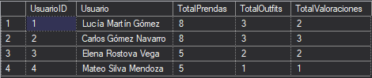

---

## 🏆 7. Funcionalidades DP-800 Implementadas (Bloques A - G)

El proyecto abarca la totalidad de los bloques funcionales y técnicos propuestos en la especificación de la certificación **Microsoft DP-800**:

### Bloque A — Diseño Relacional y Programabilidad T-SQL Avanzada
* **Integridad y Tipos de Datos:** Uso de restricciones `PRIMARY KEY`, `FOREIGN KEY`, `UNIQUE` y `CHECK` (validación de rangos de puntuación de $1$ a $5$, estados limpios/sucios y tipos de documento), junto con los nuevos tipos `JSON` y `VECTOR(768)` de SQL Server 2025.
* **Vistas Analíticas (`database/04_views.sql`):**
  * `vw_InventarioPrendasJSON`: Extrae propiedades del tipo nativo `JSON` mediante `JSON_VALUE` combinando prendas y marcas.
  * `vw_AnaliticaArmarioUsuario`: Utiliza **CTEs** y **Funciones de Ventana** (`RANK() OVER`, `AVG() OVER`, `COUNT() OVER`) para clasificar las prendas por su coste por uso y valor dentro del armario de cada propietario.
  * `vw_ResumenOutfitsExperiencias`: Consolida combinaciones de ropa con sus valoraciones históricas.
* **Funciones de Búsqueda Difusa y Expresiones Regulares (`database/05_procedures.sql`):**
  * Al activar `PREVIEW_FEATURES = ON`, la función `dbo.fn_BuscarMarcaAproximada` emplea `REGEXP_REPLACE` para limpiar caracteres especiales de la entrada del usuario y aplica algoritmos de distancia de Levenshtein con **`EDIT_DISTANCE`** y **`EDIT_DISTANCE_SIMILARITY`** para encontrar marcas aunque el usuario cometa errores tipográficos (ej. buscar *"Zarra!!"* y encontrar *"Zara"*).
* **Mantenimiento Automático de Chunks con Triggers (`trg_SincronizarChunkPrenda`):**
  * Disparador `AFTER INSERT, UPDATE` altamente optimizado: comprueba mediante `IF NOT (UPDATE(nombre) OR UPDATE(descripcion)...)` si han cambiado columnas con valor semántico. Si solo cambia el precio, el trigger no se ejecuta; si cambia el estado (por ejemplo, la prenda pasa a estar sucia o limpia) o la descripción, reconstruye automáticamente el `contenido_texto` en `DOCUMENTOS_BUSQUEDA` y establece **`embedding = NULL`** para marcar que ese vector debe recalcularse de forma incremental.
* **Procedimientos Almacenados Transaccionales:**
  * `dbo.usp_RegistrarUsoYValoracionOutfit`: Gestiona transacciones anidadas de forma defensiva usando `@@TRANCOUNT`, `SAVE TRANSACTION`, bloques `TRY...CATCH`, verificación de estado con `XACT_STATE()` y lanzamiento de errores modernos con `;THROW`. En una operación atómica incrementa el contador de usos del outfit, ensucia las prendas asociadas, inserta la valoración y crea el nuevo *chunk* de experiencia para la IA.
  * `dbo.usp_AltaPrendaConAtributosJSON`: Valida el formato de la talla mediante expresiones regulares nativas (`REGEXP_LIKE`) y construye objetos JSON válidos directamente en el motor con `JSON_OBJECT`.

---

### Bloque B — Desarrollo SQL Asistido por IA
Durante el ciclo de vida del proyecto se empleó asistencia de IA de forma auditada y verificada (documentada en `docs/`), destacando:
* **Generación de datos sintéticos coherentes:** Creación de 4 perfiles de usuario con estilos contrastados, 26 prendas ricas en matices textiles y experiencias de uso realistas para poner a prueba el motor semántico.
* **Depuración de conflictos de seguridad en Testing:** Identificación y corrección del conflicto entre el bloqueo explícito `DENY SELECT ON dbo.USUARIOS TO rol_UsuarioApp` y la prueba unitaria de *Dynamic Data Masking*, rediseñando la validación sobre el rol `usr_auditor` que sí posee permisos de lectura auditada pero carece de `UNMASK`.
* **Construcción segura de Payloads REST:** Sustitución de concatenaciones manuales de cadenas JSON por la función nativa `JSON_OBJECT` en el procedimiento RAG, evitando errores de sintaxis en la API de Ollama provocados por saltos de línea o comillas en las descripciones de las prendas.

---

### Bloque C — Seguridad Corporativa Multi-Tenant (`database/06_security.sql`)
* **Cero Secretos en Código Fuente (DevSecOps):** Creación de usuarios de base de datos mediante `CREATE USER ... WITHOUT LOGIN` (`usr_lucia`, `usr_carlos`, `usr_elena`, `usr_mateo` y `usr_auditor`), eliminando cualquier contraseña o credencial estática en los scripts de GitHub.
* **Principio de Mínimo Privilegio:** Segregación en roles (`rol_UsuarioApp` y `rol_AuditorSoporte`) utilizando sentencias `GRANT`, `DENY` (bloqueo de lectura sobre `dbo.USUARIOS` para usuarios finales y bloqueo a nivel de columna sobre `password` y `remember_token` para auditores) y `REVOKE UNMASK`.
* **Dynamic Data Masking (DDM):** Enmascaramiento dinámico en la tabla `USUARIOS` mediante `FUNCTION = 'email()'` para correos electrónicos (mostrando `lXXX@XXXX.com` al soporte técnico) y `FUNCTION = 'default()'` para tokens de sesión.
* **Row-Level Security (RLS) en Tablas y Vectores de IA:** Implementación de la función de predicado `sec.fn_PredicadoSeguridadUsuario` con `SCHEMABINDING` y la directiva `sec.Pol_AislamientoArmarioUsuario`. Aplica predicados `FILTER` (lectura silenciosa) y `BLOCK` (protección contra inserción/modificación cruzada) tanto en `PRENDAS`, `OUTFITS` y `VALORACIONES_OUTFIT` como en la tabla vectorial **`DOCUMENTOS_BUSQUEDA`**. Soporta tanto conexión directa por usuario SQL (`USER_NAME()`) como inyección de contexto desde aplicaciones web mediante **`SESSION_CONTEXT(N'usuario_id')`**.

---

### Bloque D — Optimización del Rendimiento e Índices (`database/07_indexes.sql`)
* Diseño de índices **Nonclustered de cobertura (`INCLUDE`)** orientados a los patrones de acceso más frecuentes del armario y del motor de búsqueda:
  * `IX_Prendas_Usuario_EstadoLimpia`: Optimiza el filtrado de prendas disponibles por usuario e incluye nombre, categoría, color y atributos JSON para evitar *Key Lookups*.
  * `IX_Outfits_Usuario_Ocasiones` y `IX_DocumentosBusqueda_Usuario_Tipo`: Aceleran la preselección de candidatos por usuario antes de calcular distancias vectoriales.
* **Impacto demostrado en el Plan de Ejecución:** Transformación de operaciones de barrido completo (*Clustered Index Scan*) en búsquedas dirigidas por árbol B (*Index Seek*), reduciendo las lecturas lógicas en memoria (`STATISTICS IO`) y el tiempo de CPU (`STATISTICS TIME`).

---

### Bloque E — Modelos Externos y Embeddings (`ai/01` y `ai/02`)
* **Registro Nativo del Modelo (`CREATE EXTERNAL MODEL`):** Se registra en SQL Server 2025 el objeto `ModeloEmbeddingsOllama` con formato `API_FORMAT = 'Ollama'` y `MODEL_TYPE = EMBEDDINGS`, apuntando al modelo local **`nomic-embed-text`** a través del túnel HTTPS de Caddy (`https://localhost:11435/api/embed`).
* **Vectorización Incremental:** Mediante la función nativa **`AI_GENERATE_EMBEDDINGS(contenido_texto USE MODEL ModeloEmbeddingsOllama)`**, SQL Server convierte el texto enriquecido de cada prenda, outfit y valoración en un vector matemático almacenado en la columna `embedding VECTOR(768)` de `DOCUMENTOS_BUSQUEDA`. Además, se incluye un procedimiento de mantenimiento que solo vectoriza aquellas filas cuyo `embedding IS NULL` (por ejemplo, tras ser modificadas por el trigger `trg_SincronizarChunkPrenda`).

---

### Bloque F — Intelligent Search: Vectorial, Léxica e Híbrida (`ai/03_vector_search.sql`)
* **Búsqueda Vectorial Semántica:** Transforma la consulta del usuario en un `VECTOR(768)` en tiempo real y ordena el armario utilizando `VECTOR_DISTANCE('cosine', d.embedding, @VectorConsulta)`. Es capaz de encontrar prendas ideales para *"no pasar frío en la nieve"* o *"evento elegante al aire libre"* aunque ninguna de esas palabras exista literalmente en la descripción de la ropa.
* **Justificación de la Métrica Coseno:** La distancia coseno ($\text{Distancia} = 1 - \frac{\mathbf{A} \cdot \mathbf{B}}{\|\mathbf{A}\| \|\mathbf{B}\|}$) mide el ángulo entre dos vectores en el espacio multidimensional sin verse afectada por la longitud del texto. Esto resulta crítico en `DOCUMENTOS_BUSQUEDA`, donde coexisten notas breves de valoraciones con descripciones extensas de *outfits*.
* **Búsqueda Híbrida con Reciprocal Rank Fusion (RRF):** Combina en una única consulta la precisión exacta de la búsqueda léxica por palabras clave y metadatos JSON con la comprensión conceptual de la búsqueda vectorial mediante la fórmula de fusión de rangos:
  $$\text{RRF\_Score}(d) = \frac{1}{k + \text{Rank}_{\text{Vectorial}}(d)} + \frac{1}{k + \text{Rank}_{\text{Léxico}}(d)} \quad (k = 60)$$

---

### Bloque G — RAG (Retrieval-Augmented Generation) Nativo (`ai/04_rag.sql`)
El procedimiento almacenado **`dbo.usp_ConsultarEstilistaRAG`** implementa el flujo completo de Generación Aumentada por Recuperación dentro de T-SQL:
1. **Aislamiento RLS:** Fija el `@UsuarioID` recibido mediante `sp_set_session_context`.
2. **Retrieval (Recuperación Vectorial):** Vectoriza la `@PreguntaUsuario` con `nomic-embed-text` y extrae los `@TopK` fragmentos más cercanos usando `VECTOR_DISTANCE('cosine', ...)`.
3. **Augmentation (Construcción de Contexto y Grounding):** Concatena los fragmentos recuperados usando `STRING_AGG` y los inyecta junto a un `@SystemPrompt` con técnica de **Grounding estricto**, ordenando al modelo basarse **exclusivamente** en las prendas y experiencias recuperadas sin inventar ropa.
4. **Generation (Invocación al LLM Local):** Empaqueta la petición con `JSON_OBJECT` (`stream = false`) e invoca al modelo **`llama3.2:3b`** mediante el procedimiento del sistema **`sp_invoke_external_rest_endpoint`** hacia `https://localhost:11435/api/generate`, parseando la respuesta final con `JSON_VALUE(@Response, '$.result.response')`.

| Característica | LLM Tradicional (Aislado) | Arquitectura RAG en `SmartClosetAI` |
| :--- | :--- | :--- |
| **Conocimiento del armario** | Nulo (inventa prendas genéricas). | **Total** (lee las prendas reales de `DOCUMENTOS_BUSQUEDA`). |
| **Estado y experiencias previas** | Desconoce si una prenda está sucia o si dio calor. | **Incorporado** (filtra e inyecta valoraciones y estados reales). |
| **Privacidad y Multi-Tenancy** | Sin aislamiento nativo de datos. | **Blindado con RLS** (cada usuario consulta solo sus vectores). |
| **Dependencia Cloud / Coste** | Requiere APIs externas de pago. | **100% Local y Gratuito** (SQL Server 2025 + Ollama). |

---

## 💻 8. Ejemplos de Consultas SQL: Intelligent Search, RAG y Seguridad

A continuación se presentan las sentencias T-SQL listas para ejecutar en SSMS con sus variables declaradas, diseñadas para verificar el comportamiento del motor de búsqueda inteligente, el asistente RAG y el aislamiento de seguridad.

### 8.1. Consulta de Intelligent Search (Búsqueda Semántica Vectorial)
Esta consulta transforma una necesidad expresada en lenguaje natural en un vector de $768$ dimensiones y recupera el Top 5 de prendas y experiencias semánticamente más afines para Lucía (`@UsuarioID = 1`):

```sql
USE SmartClosetAI;
GO

-- 1. Definición de variables de entrada para Intelligent Search
DECLARE @ConsultaBusqueda NVARCHAR(500) = N'Ropa fresca, transpirable y elegante para un evento de día con mucho sol';
DECLARE @UsuarioID INT = 1; -- Lucía Martín
DECLARE @TopK INT = 5;

-- 2. Establecer contexto de sesión para Row-Level Security (RLS)
EXEC sp_set_session_context @key = N'usuario_id', @value = @UsuarioID;

-- 3. Generar el vector de la consulta en tiempo real usando Ollama (nomic-embed-text)
DECLARE @VectorConsulta VECTOR(768);
SET @VectorConsulta = CAST(
    AI_GENERATE_EMBEDDINGS(@ConsultaBusqueda USE MODEL ModeloEmbeddingsOllama)
    AS VECTOR(768)
);

-- 4. Búsqueda por Similitud Coseno y Ranking de Resultados
SELECT TOP (@TopK)
    ROW_NUMBER() OVER (ORDER BY VECTOR_DISTANCE('cosine', d.embedding, @VectorConsulta) ASC) AS Ranking,
    d.id AS DocumentoID,
    d.tipo_origen AS TipoDocumento,
    d.titulo AS TituloPrendaOExperiencia,
    CAST(VECTOR_DISTANCE('cosine', d.embedding, @VectorConsulta) AS DECIMAL(8,4)) AS DistanciaCoseno,
    CAST((1.0 - VECTOR_DISTANCE('cosine', d.embedding, @VectorConsulta)) * 100.0 AS DECIMAL(5,2)) AS SimilitudPct,
    d.contenido_texto AS TextoRecuperado,
    JSON_VALUE(d.metadatos_json, '$.temporada') AS TemporadaJSON
FROM dbo.DOCUMENTOS_BUSQUEDA d
WHERE d.embedding IS NOT NULL
  AND d.usuario_id = @UsuarioID
ORDER BY DistanciaCoseno ASC;
GO
```

📸 **Resultado de la ejecución de Intelligent Search (Búsqueda Vectorial):**  
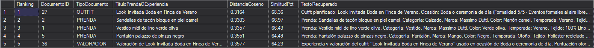

---

### 8.2. Consulta de Búsqueda Híbrida (Vectorial + Léxica con RRF)
Esta sentencia combina el ranking semántico vectorial con el ranking léxico mediante **Reciprocal Rank Fusion (RRF)** para priorizar documentos que no solo tienen alta similitud conceptual, sino que también coinciden con términos clave específicos:

```sql
USE SmartClosetAI;
GO

-- 1. Variables para Búsqueda Híbrida con RRF
DECLARE @PreguntaHibrida NVARCHAR(500) = N'conjunto impermeable o cortavientos para lluvia y frío';
DECLARE @TerminoClave NVARCHAR(100) = N'impermeable';
DECLARE @UsuarioID INT = 2; -- Carlos Gómez
DECLARE @ConstanteK_RRF INT = 60;

EXEC sp_set_session_context @key = N'usuario_id', @value = @UsuarioID;

DECLARE @VectorHibrido VECTOR(768) = CAST(
    AI_GENERATE_EMBEDDINGS(@PreguntaHibrida USE MODEL ModeloEmbeddingsOllama)
    AS VECTOR(768)
);

;WITH CTE_RankVectorial AS (
    SELECT 
        d.id,
        d.titulo,
        d.tipo_origen,
        d.contenido_texto,
        VECTOR_DISTANCE('cosine', d.embedding, @VectorHibrido) AS dist_coseno,
        ROW_NUMBER() OVER (ORDER BY VECTOR_DISTANCE('cosine', d.embedding, @VectorHibrido) ASC) AS rank_vec
    FROM dbo.DOCUMENTOS_BUSQUEDA d
    WHERE d.usuario_id = @UsuarioID AND d.embedding IS NOT NULL
),
CTE_RankLexico AS (
    SELECT 
        d.id,
        ROW_NUMBER() OVER (
            ORDER BY 
                CASE WHEN d.contenido_texto LIKE N'%' + @TerminoClave + N'%' THEN 1 ELSE 2 END ASC,
                d.id ASC
        ) AS rank_lex
    FROM dbo.DOCUMENTOS_BUSQUEDA d
    WHERE d.usuario_id = @UsuarioID
)
SELECT TOP 5
    v.id AS DocumentoID,
    v.tipo_origen AS Tipo,
    v.titulo AS Titulo,
    v.rank_vec AS RankVectorial,
    l.rank_lex AS RankLexico,
    CAST(
        (1.0 / (@ConstanteK_RRF + v.rank_vec)) + 
        (1.0 / (@ConstanteK_RRF + l.rank_lex))
    AS DECIMAL(10,6)) AS RRF_Score_Combinado,
    v.contenido_texto AS DetalleDocumento
FROM CTE_RankVectorial v
INNER JOIN CTE_RankLexico l ON v.id = l.id
ORDER BY RRF_Score_Combinado DESC;
GO
```

📸 **Resultado de la ejecución de Búsqueda Híbrida (RRF):**  
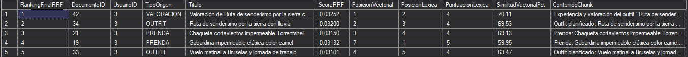

---

### 8.3. Consulta al Procedimiento RAG (`dbo.usp_ConsultarEstilistaRAG`)
Esta sentencia ejecuta el pipeline completo de **Retrieval-Augmented Generation**. Devuelve dos conjuntos de resultados: primero los `@TopK` documentos recuperados del armario con su porcentaje de similitud, y segundo la tabla consolidada con la pregunta, el bloque de contexto inyectado y la respuesta redactada por **Llama 3.2**:

```sql
USE SmartClosetAI;
GO

-- 1. Definición de variables para consultar al Estilista RAG
DECLARE @PreguntaUsuario NVARCHAR(500) = N'¿Qué conjunto me recomiendas para una boda al mediodía con mucho calor en el campo?';
DECLARE @UsuarioID INT = 1; -- Lucía Martín (ID = 1)
DECLARE @TopK INT = 3;      -- Número de chunks de contexto a recuperar

-- 2. Ejecución del procedimiento almacenado RAG
EXEC dbo.usp_ConsultarEstilistaRAG
    @PreguntaUsuario = @PreguntaUsuario,
    @UsuarioID = @UsuarioID,
    @TopK = @TopK;
GO
```

📸 **Resultado de la ejecución del Pipeline RAG en SSMS (Chunks recuperados + Respuesta de Llama 3.2):**  
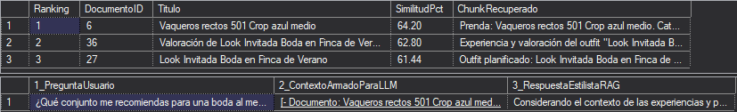

---

### 8.4. Comprobación de Seguridad Multi-Tenant (RLS y Dynamic Data Masking)
Prueba rápida para verificar cómo el motor filtra silenciosamente las prendas y vectores de IA según el usuario conectado, y cómo ofusca los correos electrónicos ante el rol de auditoría:

```sql
USE SmartClosetAI;
GO

-- 1. Simulación como Lucía (usr_lucia, ID = 1): RLS solo devuelve sus prendas y sus vectores
EXECUTE AS USER = 'usr_lucia';
    SELECT 
        USER_NAME() AS UsuarioConectado,
        COUNT(*) AS MisPrendasVisibles,
        (SELECT COUNT(*) FROM dbo.DOCUMENTOS_BUSQUEDA) AS MisChunksIAVisibles
    FROM dbo.PRENDAS;
REVERT;

-- 2. Simulación como Auditor (usr_auditor): Ve el global pero con el email enmascarado (DDM)
EXECUTE AS USER = 'usr_auditor';
    SELECT id, name, email AS EmailEnmascaradoDDM, created_at 
    FROM dbo.USUARIOS;
REVERT;
GO
```

📸 **Resultado de la comprobación de Seguridad (RLS y DDM):**  
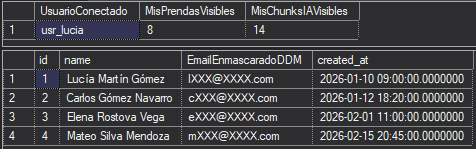

---

## 🌐 9. Demostración de la Aplicación Web (FastAPI + Streamlit)

Para llevar la solución a un entorno de producción real e interactivo, se ha construido una aplicación web ligera dentro de la carpeta `app/` dividida en dos componentes:

### 9.1. Arquitectura de la Aplicación Python
* **Backend (`app/api.py`):** Construido con **FastAPI** y **`pyodbc`**. Expone el endpoint `POST /preguntar`, que recibe el texto de la pregunta y el `usuario_id`. Se conecta a `SmartClosetAI` mediante autenticación integrada de Windows y ejecuta `EXEC dbo.usp_ConsultarEstilistaRAG @PreguntaUsuario = ?, @UsuarioID = ?`. Utiliza `cursor.nextset()` para avanzar al conjunto de resultados consolidado del procedimiento y devuelve un JSON limpio con la pregunta, el contexto recuperado y la respuesta del modelo `llama3.2:3b`.
* **Frontend (`app/chat.py`):** Construido con **Streamlit**. Ofrece una interfaz moderna tipo chat que incluye:
  1. **Selector Multi-Usuario en la barra lateral (`st.sidebar.selectbox`):** Permite cambiar en caliente entre **Lucía Martín (ID: 1)**, **Carlos Gómez (ID: 2)**, **Elena Rostova (ID: 3)** y **Mateo Silva (ID: 4)**. Al cambiar de usuario, la base de datos aplica automáticamente **Row-Level Security (RLS)** y el estilista responde únicamente con la ropa del usuario seleccionado.
  2. **Panel desplegable de transparencia (*Grounding*):** Debajo de cada respuesta del asistente, un componente `st.expander("🔍 Ver prendas encontradas en el armario (Grounding)")` muestra exactamente qué documentos de `DOCUMENTOS_BUSQUEDA` recuperó la búsqueda vectorial de SQL Server para fundamentar la respuesta.

### 9.2. Evidencia Visual de la Aplicación en Funcionamiento

📸 **Demostración en vivo de la Web App consultando el procedimiento almacenado RAG:**  <br> 
(Usuario 1, Lucía) <br> 
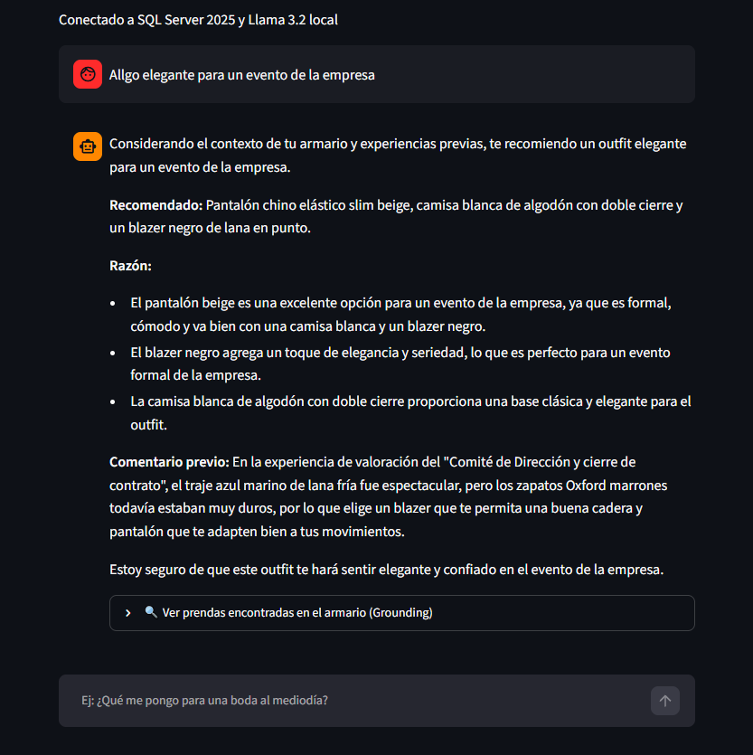

*(Opcional: Si cambias de usuario en el menú lateral de la izquierda, puedes observar cómo ante una misma pregunta la IA recomienda prendas completamente distintas respetando el aislamiento RLS de cada armario):*  
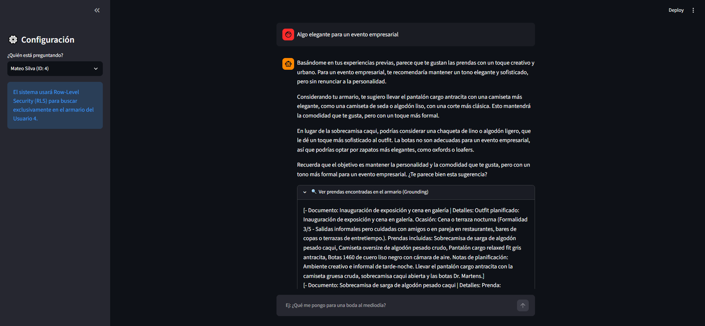


**Vistas extras de la app:**
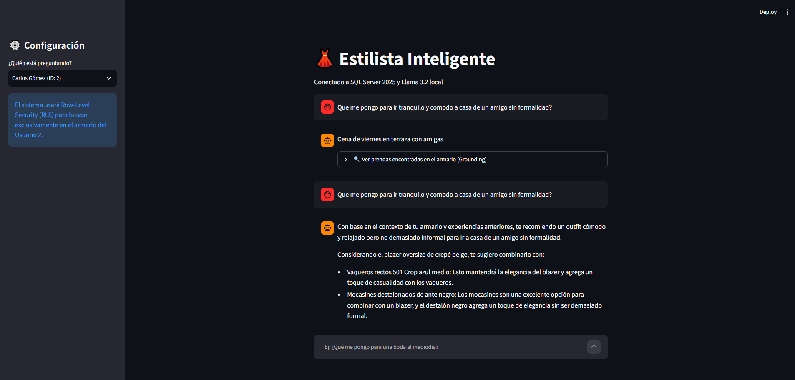
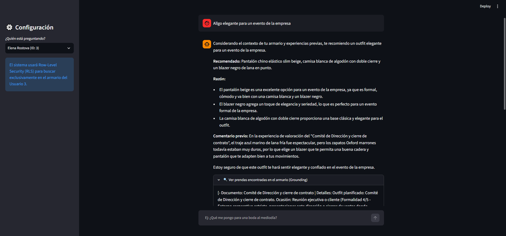
---
## ✅ 10. Batería de Pruebas Automatizadas (Testing)

El archivo **`tests/tests.sql`** implementa un script de auditoría automatizada e idempotente que verifica extremo a extremo todos los requisitos del proyecto, emitiendo un informe con estado **`PASS`** o **`FAIL`** para cada control:

* **Test Bloque A:** Existencia de las 8 tablas, validación de restricciones, funcionamiento de vistas JSON/Analíticas, ejecución de `fn_BuscarMarcaAproximada` (Fuzzy/Regex) y comprobación del trigger `trg_SincronizarChunkPrenda`.
* **Test Bloque C:** Verificación de aislamiento RLS para `usr_lucia` y `usr_carlos` (comprobando que ninguno ve filas ajenas) y verificación de enmascaramiento DDM del correo electrónico con `usr_auditor`.
* **Test Bloque D:** Comprobación en `sys.indexes` de la presencia y estado activo de los índices Nonclustered de cobertura.
* **Test Bloque E:** Verificación del registro de `ModeloEmbeddingsOllama` en `sys.external_models` y validación de que el $100\%$ de los registros en `DOCUMENTOS_BUSQUEDA` poseen su vector `VECTOR(768)` poblado (`0 NULLs`).
* **Test Bloques F y G:** Prueba funcional de distancia coseno y verificación de existencia y permisos del procedimiento `dbo.usp_ConsultarEstilistaRAG`.

📸 **Resultado de la batería de pruebas (`tests/tests.sql`):**  
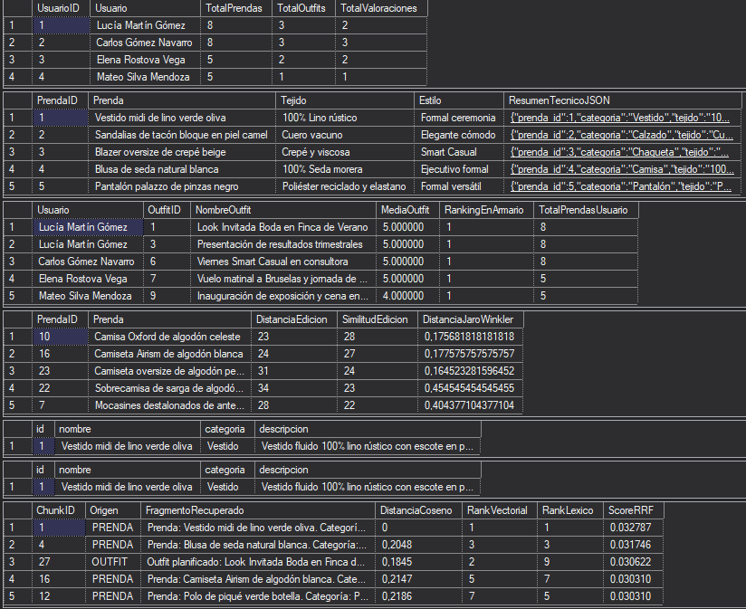
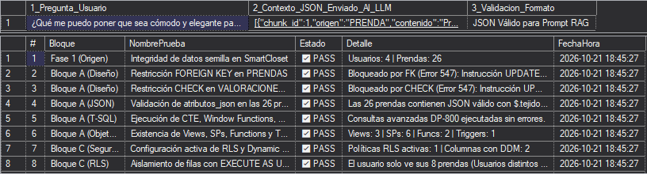

---

## 🎯 11. Conclusiones

1. **SQL Server 2025 como Motor de IA Todo-en-Uno:** La incorporación nativa del tipo de dato `VECTOR`, la función `AI_GENERATE_EMBEDDINGS`, el cálculo de similitud `VECTOR_DISTANCE` y la invocación REST mediante `sp_invoke_external_rest_endpoint` permiten construir arquitecturas **RAG completas directamente en T-SQL**, eliminando la necesidad de mantener bases de datos vectoriales externas duplicadas.
2. **Privacidad y Soberanía del Dato (100% Local):** La combinación de SQL Server 2025 con **Ollama** (`nomic-embed-text` y `llama3.2:3b`) a través del túnel TLS de **Caddy** demuestra que es posible desplegar soluciones de IA Generativa de nivel empresarial sin exponer información sensible a proveedores en la nube ni incurrir en costes por token.
3. **Seguridad y Gobernanza sin Fisuras:** Integrar los vectores dentro del propio motor relacional permite que las políticas corporativas de **Row-Level Security (RLS)** y **Dynamic Data Masking (DDM)** protejan automáticamente las consultas de Inteligencia Artificial. El LLM es físicamente incapaz de sufrir fugas de información entre usuarios porque el motor de base de datos filtra los vectores antes de construir el prompt.
4. **Integración Ágil con Ecosistemas Modernos:** Al encapsular toda la inteligencia, seguridad y orquestación RAG dentro de un único procedimiento almacenado (`dbo.usp_ConsultarEstilistaRAG`), el desarrollo de la aplicación cliente en Python (**FastAPI + Streamlit**) se simplifica al máximo, logrando un producto final limpio, mantenible y escalable.

---
<br>

**Autor:** Adrián — *Proyecto Final Certificación Microsoft DP-800 (SQL Server 2025)*

Linkedln: `https://www.linkedin.com/in/adri%C3%A1n-vivar-moreno-741951310/` <br>
GitHub: `https://github.com/Adrianvvr` <br>
Email: `adrianvivarmo@gmail.com` 

