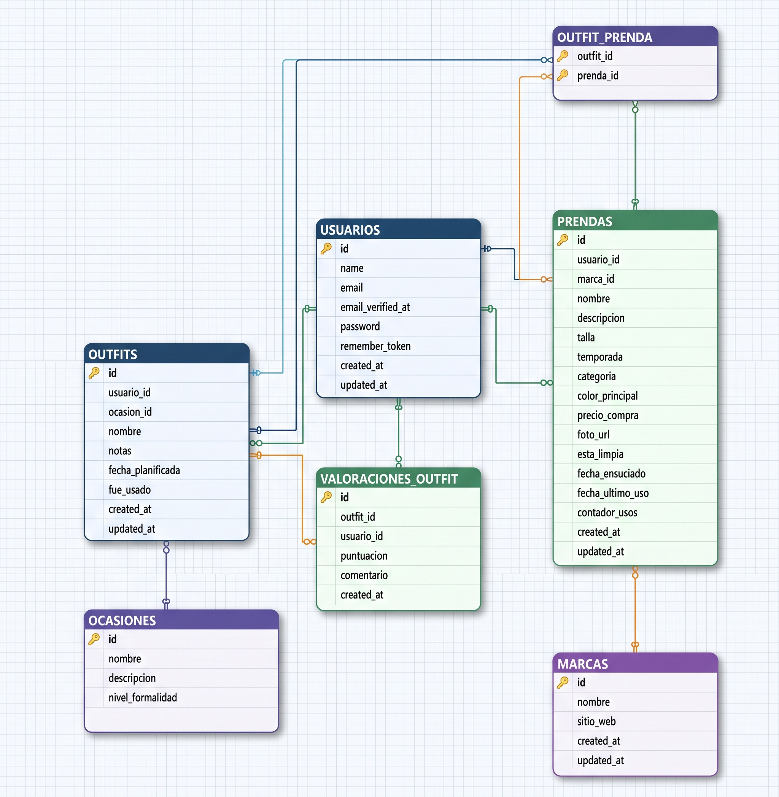

# Base de Datos completamente transaccional

## Esquema:




## Necesidades y justificación de evolución

* **Acoplamiento por gestión manual de claves primarias:** Las tablas actuales carecen de mecanismos de autogeneración nativos (como `IDENTITY` o `SEQUENCE`). Esto delega la responsabilidad de la asignación de identificadores a la capa de aplicación o a scripts manuales, lo que incrementa el riesgo de colisiones de datos, dificulta la concurrencia y penaliza la eficiencia en inserciones masivas.

* **Densidad de datos atrapada en texto libre (Prendas):** El campo `PRENDAS.descripcion` contiene atributos críticos de negocio (composición del tejido, impermeabilidad, nivel de arrugado o transpirabilidad) en formato no estructurado. La imposibilidad de filtrar estos datos de forma indexada obliga al motor a realizar costosos escaneos de tabla (`Table Scans`) mediante operadores `LIKE`, degradando drásticamente el rendimiento analítico y de búsqueda.

* **Ausencia de capacidades semánticas e Inteligencia Artificial:** El diseño actual carece de soporte para almacenamiento de embeddings vectoriales (`VECTOR`) y segmentación de texto (`chunks`). Bajo un enfoque puramente relacional, el sistema es incapaz de resolver consultas basadas en la intención del usuario; por ejemplo, una búsqueda como *"ropa fresca para una boda de día al aire libre"* jamás conectará de forma nativa con una prenda etiquetada como *"100% lino rústico transpirable"*.

* **Vulnerabilidad en seguridad de datos (RLS y Enmascaramiento):** El esquema no implementa políticas de Seguridad a Nivel de Fila (`Row-Level Security - RLS`) ni técnicas de enmascaramiento dinámico de datos (`DDM`). Como consecuencia, cualquier consulta estándar sobre las tablas `PRENDAS` o `USUARIOS` expone de forma masiva información sensible —como correos electrónicos y datos privados— a cualquier rol de base de datos, violando el principio de mínimo privilegio y normativas de privacidad.

* **Deficiencia en la estrategia de indexación secundaria:** La base de datos depende exclusivamente de los índices clúster generados por las claves primarias. La falta de índices no clúster (`Non-Clustered Indexes`) sobre los atributos de filtrado más frecuentes (como categorías, fechas o claves foráneas) satura el subsistema de E/S al forzar búsquedas secuenciales en consultas cotidianas.


## Verificación del estado inicial

```sql
USE SmartCloset;
GO

SELECT 
    u.id AS UsuarioID,
    u.name AS Usuario,
    COUNT(DISTINCT p.id) AS TotalPrendas,
    COUNT(DISTINCT o.id) AS TotalOutfits,
    COUNT(DISTINCT v.id) AS TotalValoraciones
FROM USUARIOS u
LEFT JOIN PRENDAS p ON u.id = p.usuario_id
LEFT JOIN OUTFITS o ON u.id = o.usuario_id
LEFT JOIN VALORACIONES_OUTFIT v ON u.id = v.usuario_id
GROUP BY u.id, u.name
ORDER BY u.id;
```


