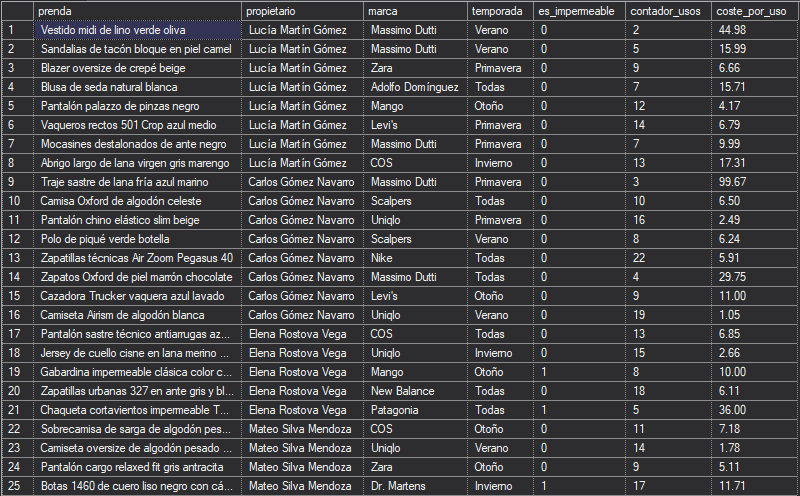
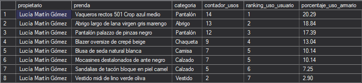
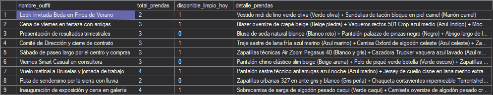
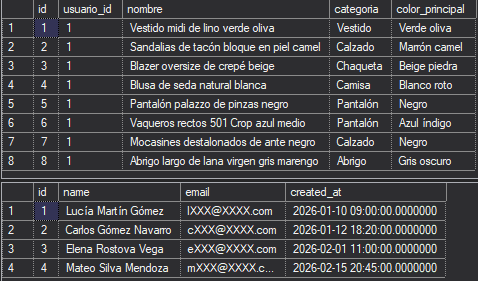
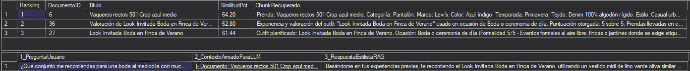

# BLOQUE A — Diseño y desarrollo de la base de datos

## 1. Diseño Relacional, Tipos de Datos e Índices

**Explicación general:** La base de datos se ha diseñado para representar el armario de diferentes usuarios, conectando quiénes son, qué ropa tienen, de qué marca es y en qué "outfits" (conjuntos) deciden combinarla. Para que el sistema no guarde información errónea, hemos puesto reglas: los precios no pueden ser negativos, los correos deben tener formato válido y, si se borra un conjunto, se limpian automáticamente sus relaciones para no dejar datos huérfanos. Además, introdujimos índices para que buscar prendas limpias sea instantáneo.

**Explicación técnica:** El esquema relacional implementa `PRIMARY KEY` (con `IDENTITY` y `SEQUENCE`), `FOREIGN KEY` (algunas con `ON DELETE CASCADE`), y restricciones `CHECK` y `UNIQUE`. Se utilizan tipos de datos modernos como `JSON` nativo (para atributos dinámicos de la ropa), `VECTOR(768)` para la IA y `DATETIME2` para auditoría. Para la optimización, se han creado índices compuestos, filtrados (ej. `WHERE esta_limpia = 1`) y cubrientes (`INCLUDE`). Para los datos de prueba, se inyectan registros realistas y un volumen temporal de 2000 prendas para pruebas de rendimiento.

### Tablas, Relaciones y Restricciones

```sql
CREATE TABLE PRENDAS (
    id INT IDENTITY(1,1) CONSTRAINT PK_PRENDAS PRIMARY KEY CLUSTERED,
    usuario_id INT NOT NULL,
    marca_id INT NULL,
    nombre NVARCHAR(150) NOT NULL,
    categoria NVARCHAR(50) NOT NULL,
    color_principal NVARCHAR(50) NOT NULL,
    atributos_json JSON NULL,
    precio_compra DECIMAL(10,2) NULL CONSTRAINT CK_PRENDAS_PRECIO CHECK (precio_compra >= 0),
    esta_limpia BIT NOT NULL CONSTRAINT DF_PRENDAS_LIMPIA DEFAULT 1,
    CONSTRAINT FK_PRENDAS_USUARIOS FOREIGN KEY (usuario_id) REFERENCES USUARIOS(id),
    CONSTRAINT FK_PRENDAS_MARCAS FOREIGN KEY (marca_id) REFERENCES MARCAS(id)
);

CREATE TABLE OUTFIT_PRENDA (
    outfit_id INT NOT NULL,
    prenda_id INT NOT NULL,
    CONSTRAINT PK_OUTFIT_PRENDA PRIMARY KEY CLUSTERED (outfit_id, prenda_id),
    CONSTRAINT FK_OUTFIT_PRENDA_OUTFITS FOREIGN KEY (outfit_id) REFERENCES OUTFITS(id) ON DELETE CASCADE,
    CONSTRAINT FK_OUTFIT_PRENDA_PRENDAS FOREIGN KEY (prenda_id) REFERENCES PRENDAS(id) ON DELETE CASCADE
);
```

### Inserción de Datos de Prueba

```sql
SET IDENTITY_INSERT PRENDAS ON;

INSERT INTO PRENDAS (
    id, usuario_id, marca_id, nombre, descripcion, talla, categoria, 
    color_principal, atributos_json, precio_compra, esta_limpia, 
    fecha_ensuciado, fecha_ultimo_uso, contador_usos
) VALUES
(1, 1, 1, N'Vestido midi de lino verde oliva', 
 N'Vestido fluido 100% lino rústico con escote en pico...', 
 N'M', N'Vestido', N'Verde oliva', 
 N'{"temporada": "Verano", "tejido": "100% Lino rústico", "impermeable": false}', 
 89.95, 1, NULL, '2026-06-20 23:00:00', 2);

SET IDENTITY_INSERT PRENDAS OFF;
```

### Índices Optimizados

```sql
CREATE NONCLUSTERED INDEX IX_PRENDAS_Usuario_Categoria_Limpia
ON dbo.PRENDAS (usuario_id ASC, categoria ASC, contador_usos DESC)
INCLUDE (nombre, color_principal, precio_compra, marca_id)
WHERE esta_limpia = 1;
```

## 2. Objetos de Programabilidad

**Explicación general:** Para no tener que escribir consultas complejas constantemente o correr el riesgo de dejar datos a medias, hemos guardado piezas de código dentro de la base de datos. Por un lado, tenemos "Vistas", que actúan como vitrinas que nos muestran la información ya masticada y unida. Por otro lado, tenemos "Procedimientos", que son como interruptores maestros que, cuando se pulsan, realizan varias acciones seguras de golpe (por ejemplo, registrar que se usó una ropa, subir su contador y marcarla como sucia).

**Explicación técnica:** Se han implementado `VIEWS` para encapsular la lógica de negocio y presentación de datos combinados de múltiples tablas. Se han desarrollado `STORED PROCEDURES` transaccionales manejando `TRY...CATCH`, `XACT_ABORT` y `XACT_STATE()` para garantizar la atomicidad (ACID) al actualizar múltiples tablas simultáneamente (Outfits, Prendas, Valoraciones y Documentos).

### Creación de Vistas (View)

```sql
CREATE OR ALTER VIEW dbo.vw_InventarioPrendasJSON
AS
SELECT 
    p.id AS prenda_id,
    p.usuario_id,
    u.name AS propietario,
    p.nombre AS prenda,
    ISNULL(m.nombre, N'Sin marca') AS marca,
    p.categoria,
    p.color_principal,
    JSON_VALUE(p.atributos_json, '$.temporada') AS temporada,
    CAST(JSON_VALUE(p.atributos_json, '$.impermeable') AS BIT) AS es_impermeable,
    p.esta_limpia,
    p.contador_usos,
    p.precio_compra,
    CAST(
        p.precio_compra / NULLIF(p.contador_usos, 0) 
        AS DECIMAL(10,2)
    ) AS coste_por_uso
FROM dbo.PRENDAS p
INNER JOIN dbo.USUARIOS u ON p.usuario_id = u.id
LEFT JOIN dbo.MARCAS m ON p.marca_id = m.id;


SELECT 
    prenda,
    propietario,
    marca,
    temporada,
    es_impermeable,
    contador_usos,
    coste_por_uso
FROM dbo.vw_InventarioPrendasJSON
WHERE temporada IS NOT NULL;
```


### Procedimientos Almacenados Transaccionales (Stored Procedure)

```sql
CREATE OR ALTER PROCEDURE dbo.usp_AltaPrendaConAtributosJSON
    @UsuarioID INT,
    @MarcaID INT = NULL,
    @Nombre NVARCHAR(150),
    @Categoria NVARCHAR(50),
    @ColorPrincipal NVARCHAR(50),
    @Temporada NVARCHAR(50),
    @Impermeable BIT = 0,
    @PrecioCompra DECIMAL(10,2) = NULL,
    @NuevaPrendaID INT OUTPUT
AS
BEGIN
    SET NOCOUNT ON;
    SET XACT_ABORT ON;

    DECLARE @TranCounter INT = @@TRANCOUNT;
    DECLARE @AtributosJSON JSON;

    BEGIN TRY
        SET @AtributosJSON = CAST(
            JSON_OBJECT(
                'temporada': @Temporada,
                'impermeable': @Impermeable
            ) AS JSON
        );

        IF @TranCounter = 0
            BEGIN TRANSACTION;

        INSERT INTO dbo.PRENDAS (
            usuario_id, marca_id, nombre, categoria, color_principal, atributos_json, precio_compra, esta_limpia
        )
        VALUES (
            @UsuarioID, @MarcaID, @Nombre, @Categoria, @ColorPrincipal, @AtributosJSON, @PrecioCompra, 1
        );

        SET @NuevaPrendaID = SCOPE_IDENTITY();

        IF @TranCounter = 0
            COMMIT TRANSACTION;
    END TRY
    BEGIN CATCH
        IF XACT_STATE() <> 0 AND @TranCounter = 0
            ROLLBACK TRANSACTION;
        ;THROW;
    END CATCH;
END;
```

## 3. Consultas T-SQL Avanzadas

**Explicación general:** Aquí dotamos de inteligencia analítica a la base de datos sin necesidad de procesar los datos fuera de ella. Logramos saber de forma automática cuáles son las prendas favoritas de cada usuario organizadas por ranking, qué porcentaje de uso representan en su armario completo y verificar rápidamente si todas las prendas que componen un conjunto planificado están limpias y listas para usarse hoy.

**Explicación técnica:** Se emplean múltiples capacidades de T-SQL moderno. En la analítica, utilizamos **CTEs** (Common Table Expressions) para preparar el conjunto de datos base, seguido de **Window Functions** (`DENSE_RANK`, `ROW_NUMBER`, `SUM() OVER`, `AVG() OVER`) para calcular rankings relativos y métricas de cuota de uso particionadas por usuario. En las vistas de resumen, empleamos **Subconsultas Correlacionadas** y verificadores de existencia (`EXISTS`), junto con funciones de agregación de cadenas (**`STRING_AGG`**).

### Demostración 1: CTE y Window Functions

```sql
WITH CTE_MetricasBase AS (
    SELECT 
        p.id AS prenda_id,
        p.usuario_id,
        u.name AS propietario,
        p.nombre AS prenda,
        p.categoria,
        p.precio_compra,
        p.contador_usos
    FROM dbo.PRENDAS p
    INNER JOIN dbo.USUARIOS u ON p.usuario_id = u.id
)
SELECT 
    propietario,
    prenda,
    categoria,
    contador_usos,
    DENSE_RANK() OVER (
        PARTITION BY usuario_id 
        ORDER BY contador_usos DESC
    ) AS ranking_uso_usuario,
    CAST(
        (contador_usos * 100.0) / NULLIF(SUM(contador_usos) OVER (PARTITION BY usuario_id), 0)
        AS DECIMAL(5,2)
    ) AS porcentaje_uso_armario
FROM CTE_MetricasBase
WHERE usuario_id = 1;
```


### Demostración 2: Subconsultas Correlacionadas y Agregación de Cadenas

```sql
SELECT 
    o.nombre AS nombre_outfit,
    (
        SELECT COUNT(*) 
        FROM dbo.OUTFIT_PRENDA op 
        WHERE op.outfit_id = o.id
    ) AS total_prendas,
    CASE 
        WHEN EXISTS (
            SELECT 1 
            FROM dbo.OUTFIT_PRENDA op
            INNER JOIN dbo.PRENDAS p ON op.prenda_id = p.id
            WHERE op.outfit_id = o.id AND p.esta_limpia = 0
        ) THEN CAST(0 AS BIT)
        ELSE CAST(1 AS BIT)
    END AS disponible_limpio_hoy,
    prendas_lista.detalle_prendas
FROM dbo.OUTFITS o
OUTER APPLY (
    SELECT STRING_AGG(CONCAT(p.nombre, N' (', p.color_principal, N')'), N' + ') AS detalle_prendas
    FROM dbo.OUTFIT_PRENDA op
    INNER JOIN dbo.PRENDAS p ON op.prenda_id = p.id
    WHERE op.outfit_id = o.id
) prendas_lista;
```
  

# BLOQUE B — Desarrollo SQL asistido por IA

## Caso Práctico: Identificación y Resolución de Errores en Identidad

**Explicación general:**
Durante la fase de construcción de la base de datos, utilicé la Inteligencia Artificial como un compañero de desarrollo (*pair programming*). En lugar de pedirle que hiciera todo el trabajo por mí, recurrí a la IA cuando me encontré con un obstáculo técnico al limpiar mis tablas y reiniciar los números identificadores de mis registros. Fue una herramienta clave para entender por qué el motor de base de datos se comportaba de forma inesperada.

**Explicación técnica:**
Me encontré con un problema al intentar reiniciar las columnas `IDENTITY` de las tablas después de vaciarlas. Específicamente, el comando `DBCC CHECKIDENT` con `RESEED, 0` presentaba un comportamiento anómalo en tablas vaciadas mediante la instrucción `DELETE` en lugar de `TRUNCATE` (el cual no podía usar debido a las restricciones de Clave Foránea). Utilicé la IA para diagnosticar este error de validación[cite: 2].

### Registro de Interacción con la IA; ejemplos puntuales (AI Log) 

1.  **El prompt utilizado:**
    > "Al ejecutar `DBCC CHECKIDENT ('USUARIOS', RESEED, 0)` después de un `DELETE` total para reiniciar la base de datos, los siguientes inserts fallan o generan un ID que no espero. ¿Por qué ocurre esto y cómo puedo solucionarlo en mi script de *seed data*?"
2.  **La respuesta proporcionada por la IA:**
    La IA me explicó que SQL Server maneja el `RESEED` de manera distinta dependiendo de si la tabla ha sido "tocada" previamente o no. Si se hace `DELETE` en una tabla que tuvo datos, un `RESEED, 0` provocará que la próxima inserción tome el valor `0` (en lugar de `1`), lo que puede causar fallos de lógica o en las claves foráneas. Me sugirió varias alternativas, como usar tablas temporales o forzar los IDs.
3.  **Qué partes fueron aceptadas:**
    Acepté la explicación técnica del comportamiento interno de `DBCC CHECKIDENT` y la validación real del problema del `RESEED, 0` en tablas vaciadas[cite: 2].
4.  **Qué partes tuvieron que ser corregidas:**
    La IA inicialmente propuso mantener el `IDENTITY` y jugar con los valores de reseed (poner 1 a veces, 0 otras). Corregí este enfoque optando por algo más drástico y seguro propuesto posteriormente: desactivar temporalmente o quitar `IDENTITY` en la tabla original para ese paso, y utilizar `SET IDENTITY_INSERT ON` para insertar los IDs de prueba explícitamente (1, 2, 3...)[cite: 2, 4].
5.  **Cómo se verificó que el código generado era correcto:**
    Verifiqué la solución aplicando `SET IDENTITY_INSERT` en el script `database/02_seed_data.sql`[cite: 2]. Ejecuté el script completo y comprobé que los 4 usuarios y el resto de relaciones se insertaban funcionando perfectamente sin errores de colisión ni descuadres de claves foráneas[cite: 2, 4].

```sql
-- Demostración de la solución validada aplicada al código final
DELETE FROM USUARIOS;

-- Solución aplicada: Forzar el ID explícito apagando la identidad automática temporalmente
SET IDENTITY_INSERT USUARIOS ON;

INSERT INTO USUARIOS (id, name, email, password) VALUES
(1, N'Lucía Martín Gómez', N'lucia.martin@smartcloset.es', N'***'),
(2, N'Carlos Gómez Navarro', N'carlos.gomez@smartcloset.es', N'***');

SET IDENTITY_INSERT USUARIOS OFF;
```


# BLOQUE C — Seguridad de SQL Server

**Explicación general:**

La seguridad de la base de datos se ha diseñado siguiendo el principio de "mínimo privilegio" y protección por diseño. Nadie, excepto el administrador, puede acceder libremente a toda la información. Hemos creado un sistema donde los usuarios de la aplicación no tienen contraseñas almacenadas en el código, los datos sensibles (como los correos electrónicos) se muestran enmascarados al personal de soporte técnico, y cada usuario de la aplicación está encapsulado en su propio "armario", siendo incapaz de ver o modificar la ropa de los demás, todo de forma automática sin cambiar el código de la aplicación.

**Explicación técnica:**

La implementación cubre múltiples capas de seguridad obligatorias para el Nivel 3. Se utilizan usuarios `WITHOUT LOGIN` asignados a roles de base de datos (`rol_UsuarioApp`, `rol_AuditorSoporte`) para evitar credenciales estáticas en repositorios. Se aplican políticas de `Dynamic Data Masking (DDM)` en columnas sensibles. El acceso granular se gestiona mediante instrucciones `GRANT`, `DENY` y `REVOKE`. Finalmente, se implementa una arquitectura multi-tenant utilizando `Row-Level Security (RLS)` basada en funciones de predicado (`SCHEMABINDING`) que soportan tanto usuarios mapeados de SQL Server como el contexto de sesión (`SESSION_CONTEXT`) para aplicaciones web.

## 1. Usuarios Sin Secretos y Roles (Mínimo Privilegio)

Se han creado roles específicos y usuarios sin login, asignando permisos únicamente a los recursos necesarios para operar, bloqueando explícitamente el acceso a la tabla de usuarios para evitar enumeración.

```sql
-- Creación de roles y usuarios 
CREATE ROLE rol_UsuarioApp;
CREATE ROLE rol_AuditorSoporte;

CREATE USER usr_lucia WITHOUT LOGIN;
ALTER ROLE rol_UsuarioApp ADD MEMBER usr_lucia;

CREATE USER usr_auditor WITHOUT LOGIN;
ALTER ROLE rol_AuditorSoporte ADD MEMBER usr_auditor;

-- Principio de mínimo privilegio: permisos granulares y bloqueos
GRANT SELECT, INSERT, UPDATE, DELETE ON dbo.PRENDAS TO rol_UsuarioApp;
GRANT EXECUTE ON dbo.usp_AltaPrendaConAtributosJSON TO rol_UsuarioApp;
DENY SELECT, INSERT, UPDATE, DELETE ON dbo.USUARIOS TO rol_UsuarioApp;

GRANT SELECT ON SCHEMA::dbo TO rol_AuditorSoporte;
DENY SELECT ON dbo.USUARIOS (password, remember_token) TO rol_AuditorSoporte;
```

## 2. Dynamic Data Masking (DDM)

Se enmascara la información de identificación personal (PII) para que el rol de auditoría o soporte técnico no pueda visualizar los datos en claro. Se han revocado los permisos `UNMASK` para asegurar la restricción.

```sql
-- Enmascaramiento del correo electrónico y tokens
ALTER TABLE dbo.USUARIOS 
ALTER COLUMN email ADD MASKED WITH (FUNCTION = 'email()');

ALTER TABLE dbo.USUARIOS 
ALTER COLUMN remember_token ADD MASKED WITH (FUNCTION = 'default()');

-- Revocación de permisos para ver datos en claro
REVOKE UNMASK FROM rol_UsuarioApp;
REVOKE UNMASK FROM rol_AuditorSoporte;
```

## 3. Row-Level Security (RLS) Multi-Tenant

Aislamiento de la información mediante directivas de seguridad. Una vez aplicada la política, los filtros `SELECT` actúan silenciosamente en el motor sin necesidad de añadir sentencias `WHERE` en las aplicaciones cliente.

```sql
-- Función de seguridad de predicado
CREATE OR ALTER FUNCTION sec.fn_PredicadoSeguridadUsuario(@usuario_id INT)
RETURNS TABLE
WITH SCHEMABINDING
AS
RETURN
    SELECT 1 AS acceso_permitido
    WHERE 
        IS_MEMBER('db_owner') = 1 
        OR IS_ROLEMEMBER('rol_AuditorSoporte') = 1
        OR CAST(SESSION_CONTEXT(N'usuario_id') AS INT) = @usuario_id
        OR (USER_NAME() = N'usr_lucia' AND @usuario_id = 1)
        OR (USER_NAME() = N'usr_carlos' AND @usuario_id = 2);
GO

-- Aplicación de la Política de Seguridad bloqueando SELECT (FILTER) y operaciones DML (BLOCK)
CREATE SECURITY POLICY sec.Pol_AislamientoArmarioUsuario
    ADD FILTER PREDICATE sec.fn_PredicadoSeguridadUsuario(usuario_id) ON dbo.PRENDAS,
    ADD BLOCK PREDICATE sec.fn_PredicadoSeguridadUsuario(usuario_id) ON dbo.PRENDAS AFTER INSERT
WITH (STATE = ON);
```

## 4. Consultas de Verificación de Seguridad

Las siguientes pruebas demuestran la eficacia de las políticas implementadas. El script interactúa utilizando el contexto del usuario (`EXECUTE AS USER`) para validar el aislamiento y el enmascaramiento.

```sql
-- Ejecución como 'usr_lucia' (Usuario ID = 1): Verifica el aislamiento de prendas (RLS)
EXECUTE AS USER = 'usr_lucia';

    -- Solo devolverá sus prendas asignadas, ocultando el resto
    SELECT id, usuario_id, nombre, categoria, color_principal 
    FROM dbo.PRENDAS;

REVERT;
GO

-- Ejecución como 'usr_auditor': Verifica el enmascaramiento (DDM)
EXECUTE AS USER = 'usr_auditor';

    -- Devolverá los correos enmascarados si no dispone del permiso UNMASK
    SELECT id, name, email, created_at 
    FROM dbo.USUARIOS;

REVERT;
GO
```
  

Markdown
# BLOQUE D — Optimización de consultas

## Estudio de Rendimiento y Estrategia de Indexación

**Explicación general:**
Para que la aplicación sea rápida cuando tenga miles de prendas, no basta con guardar los datos; hay que ordenarlos inteligentemente. Hemos creado un "laboratorio de pruebas" inyectando miles de prendas falsas temporalmente. Luego, pedimos al sistema que busque una prenda específica. Primero lo hace sin "índices" (como buscar una palabra leyendo un libro entero página por página) y luego lo hace con "índices" (como ir al índice alfabético del final del libro). Medimos la diferencia de esfuerzo y demostramos cómo nuestra optimización hace que la base de datos trabaje mucho menos y responda mucho más rápido.

**Explicación técnica:**
Para evidenciar el impacto de la optimización en un entorno con poco volumen real, se inyectaron 2000 registros sintéticos para superar el umbral de decisión del optimizador de SQL Server (forzando un recorrido de múltiples páginas de 8KB). Se ejecutó una consulta típica (`SELECT` por usuario, categoría y estado de limpieza) activando `SET STATISTICS IO, TIME ON`. 
*   **Antes:** El optimizador resolvía la consulta mediante un **Clustered Index Scan**, leyendo gran cantidad de páginas de datos y aplicando filtros en memoria.
*   **Optimización:** Se creó un **Índice No Agrupado (Non-Clustered)** compuesto por las columnas de búsqueda (`usuario_id`, `categoria`), ordenado por la columna de clasificación (`contador_usos DESC`), con una cláusula **INCLUDE** cubriente (para evitar *Key Lookups*) y un filtro **WHERE** (`esta_limpia = 1`) para reducir el tamaño del árbol B+. También se añadió soporte para atributos semiestructurados mediante el nuevo **JSON INDEX** de SQL Server 2025.
*   **Después:** El optimizador utilizó el nuevo índice realizando un **Index Seek** puro, cayendo drásticamente el coste general y las lecturas lógicas (*Logical Reads*). 
*   *(Nota técnica de arquitectura)*: Al estar RLS (Row-Level Security) activo, el índice cubriente (`INCLUDE`) fue clave para que las validaciones de seguridad se evaluaran sin tener que ir a buscar datos a la tabla principal (lo que habría provocado *Key Lookups* y lecturas lógicas adicionales, pasando de 2 a 6 lecturas, como se diagnosticó durante el desarrollo).

### 1. Estado Inicial (Antes de la optimización)

Ejecución de la consulta sin índices secundarios, forzando al motor a leer de forma secuencial.

```sql
-- Ejecución con SET STATISTICS IO ON
SELECT p.id, p.nombre, p.categoria, p.descripcion
FROM SmartCloset.dbo.PRENDAS p
WHERE p.usuario_id = 1 AND p.categoria = N'Vestido';
```
Resultado:

Execution Plan: Clustered Index Scan.

Coste: Alto (lectura completa de la tabla).

Logical Reads: 5 páginas leídas.

2. Optimización Aplicada
Creación de índices diseñados específicamente para cubrir consultas concurrentes y filtrar datos innecesarios.

```sql
-- Índice Compuesto, Cubriente y Filtrado para la consulta principal
CREATE NONCLUSTERED INDEX IX_PRENDAS_Usuario_Categoria_Limpia
ON dbo.PRENDAS (usuario_id ASC, categoria ASC, contador_usos DESC)
INCLUDE (nombre, color_principal, precio_compra, marca_id)
WHERE esta_limpia = 1;

-- Índice Cubriente necesario para RLS puro (Index Seek total sin Key Lookup)
CREATE NONCLUSTERED INDEX IX_PRENDAS_Usuario_Categoria_Covering
ON SmartClosetAI.dbo.PRENDAS (usuario_id, categoria)
INCLUDE (nombre, descripcion);

-- Índice JSON nativo (SQL Server 2025)
CREATE JSON INDEX IX_PRENDAS_AtributosJSON
ON dbo.PRENDAS (atributos_json)
FOR ('$');
3. Resultado Final (Después de la optimización)
Ejecución de la misma consulta utilizando el esquema optimizado (SmartClosetAI).
```
```sql
-- Ejecución con SET STATISTICS IO ON tras aplicar la indexación
SELECT p.id, p.nombre, p.categoria, p.descripcion
FROM SmartClosetAI.dbo.PRENDAS p
WHERE p.usuario_id = 1 AND p.categoria = N'Vestido';
```
Comparativa y Justificación:

Execution Plan: Index Seek.

Coste: Mínimo.

Logical Reads: 2 páginas leídas (Reducción significativa frente a las 5 o más lecturas del escaneo original).

Justificación de mejora: La optimización es rotunda. Al usar un índice que ya contiene en sus hojas (INCLUDE) exactamente las columnas que el SELECT pide y que además está pre-filtrado por seguridad y estado de la prenda, SQL Server navega directo al nodo correcto del árbol B+. No tiene que ordenar los datos ni ir a buscar a la tabla original (Key Lookup), ahorrando I/O (operaciones de disco/memoria) y tiempo de CPU de forma exponencial a medida que la tabla crece.

**Auditoría Integral de Pruebas (Test Suite)**<br>
Se incluye como evidencia el resultado de la ejecución del script maestro de pruebas (`tests.sql`), que automatiza la validación de integridad, restricciones, seguridad RLS/DDM, JSON y los componentes avanzados de IA (Bloques E, F y G).


# BLOQUE E — Modelos y embeddings

## Arquitectura, Integración y Generación de Vectores

**Explicación general:**

Para que la base de datos deje de ser un simple almacén y se convierta en un asistente inteligente, necesitamos enseñarle a "leer" y entender el contexto de la ropa. Para ello, tomamos toda la información de cada prenda, conjunto o valoración (nombre, color, tejido, opiniones) y la transformamos en una lista de coordenadas matemáticas (vectores). Esto permite que el sistema entienda que "fresco" y "lino" están relacionados matemáticamente, aunque no sean la misma palabra. Para garantizar la privacidad absoluta del armario del usuario, todo este "razonamiento" lo hace un modelo local instalado en nuestra propia máquina, sin enviar datos a la nube.

**Explicación técnica y resolución de requisitos:**

Para lograr esta integración nativa en SQL Server 2025, se ha configurado un modelo local protegido por un proxy TLS (Caddy) para cumplir con el requisito de HTTPS estricto del motor de base de datos.

A continuación, se detalla la resolución exacta de los puntos exigidos para este bloque:

- **Qué modelo se ha utilizado:** Se ha utilizado el modelo local `nomic-embed-text` ejecutado a través de **Ollama**.
- **Qué columnas se utilizan para crear el embedding:** Se utilizan fragmentos de texto enriquecidos (*chunks*) almacenados en la columna `contenido_texto` de la tabla `DOCUMENTOS_BUSQUEDA`. Este texto es una concatenación dinámica (creada mediante triggers) que une columnas de múltiples tablas de origen: `PRENDAS` (nombre, categoría, color, atributos JSON como tejido o estilo), `OUTFITS` (notas, nivel de formalidad) y `VALORACIONES_OUTFIT` (puntuación y comentarios).
- **Qué dimensión tiene el vector:** El vector tiene **768 dimensiones**, correspondientes a la salida del modelo `nomic-embed-text`.
- **Cómo se generan los embeddings:** Se generan invocando la función nativa `AI_GENERATE_EMBEDDINGS` de SQL Server 2025 (habilitando *Preview Features*), pasándole el texto de entrada y utilizando la cláusula `USE MODEL` apuntando al modelo externo registrado.
- **Cómo se almacenan en SQL Server:** Se almacenan de forma nativa utilizando el nuevo tipo de dato `VECTOR(768)` en la columna `embedding` de la tabla `DOCUMENTOS_BUSQUEDA`.

### 1. Diagrama de Arquitectura IA Local


### 2. Configuración y Registro del Modelo Externo

Se habilitan los endpoints REST salientes y se registra la conexión con la API de Ollama mediante el comando `CREATE EXTERNAL MODEL`. Se utiliza un proxy inverso en el puerto `11435` para proveer el certificado HTTPS requerido por SQL Server.

```sql
-- 1. Habilitar llamadas a endpoints REST externos e IA en Preview
EXEC sp_configure 'external rest endpoint enabled', 1;
RECONFIGURE WITH OVERRIDE;

ALTER DATABASE SCOPED CONFIGURATION SET PREVIEW_FEATURES = ON;

-- 2. Registro del EXTERNAL MODEL apuntando al proxy HTTPS local
CREATE EXTERNAL MODEL ModeloEmbeddingsOllama
WITH (
    LOCATION = 'https://localhost:11435/api/embed',
    API_FORMAT = 'Ollama',
    MODEL_TYPE = EMBEDDINGS,
    MODEL = 'nomic-embed-text'
);

-- 3. Verificación de registro
SELECT name, location, api_format, model_type_desc, model 
FROM sys.external_models 
WHERE name = 'ModeloEmbeddingsOllama';
```

### 3. Generación Masiva y Mantenimiento de Embeddings

En lugar de recalcular vectores constantemente, se implementa un procedimiento almacenado incremental que escanea los documentos que han sido insertados o modificados recientemente (donde el trigger puso el embedding a nulo) y llama a la IA para generar el nuevo array matemático.

```sql
CREATE OR ALTER PROCEDURE dbo.usp_SincronizarEmbeddingsPendientes
AS
BEGIN
    SET NOCOUNT ON;

    -- Vectorizamos únicamente los chunks nuevos o modificados (Carga Delta)
    UPDATE dbo.DOCUMENTOS_BUSQUEDA
    SET embedding = CAST(
        AI_GENERATE_EMBEDDINGS(contenido_texto USE MODEL ModeloEmbeddingsOllama)
        AS VECTOR(768)
    ),
    updated_at = SYSDATETIME()
    WHERE embedding IS NULL;
    
    -- Reporte de completitud
    SELECT 
        tipo_origen,
        COUNT(*) AS TotalChunks,
        SUM(CASE WHEN embedding IS NOT NULL THEN 1 ELSE 0 END) AS ChunksConVector768
    FROM dbo.DOCUMENTOS_BUSQUEDA
    GROUP BY tipo_origen;
END;
GO

-- Ejecución de la vectorización
EXEC dbo.usp_SincronizarEmbeddingsPendientes;
```


# BLOQUE F — Intelligent Search

## Construcción del Motor de Búsqueda Semántica e Híbrida

**Explicación general:**

En las bases de datos tradicionales, si buscas "ropa fresca" y la descripción del producto dice "vestido de lino transpirable", no encuentras nada porque las palabras no coinciden exactamente. Para solucionar esto, hemos construido un motor de búsqueda en SQL Server que funciona de dos formas y luego las combina:

1. **Búsqueda Vectorial (Semántica):** Entiende el "significado" de las palabras gracias a los vectores que calculamos en el paso anterior. Así, "fresco" se acerca matemáticamente a "lino".
2. **Búsqueda Léxica:** Busca las palabras clave exactas que son importantes.
3. **Búsqueda Híbrida:** Une las dos anteriores. Es como tener a dos expertos (uno que busca por significado y otro por palabra exacta) y fusionar sus recomendaciones para darte la mejor lista posible.

**Explicación técnica:**

El script de búsqueda aborda los requisitos del nivel avanzado desarrollando dos procedimientos almacenados. El primero implementa **Vector Search** (algoritmo KNN) utilizando la métrica `VECTOR_DISTANCE` con medida `cosine`, obteniendo el nivel de similitud angular entre el embedding de la pregunta del usuario y los vectores de la base de datos (chunks de prendas/outfits). El segundo implementa **Hybrid Search**, fusionando el ranking vectorial con un ranking léxico. Se diseñó un fallback robusto en T-SQL puro (tokenizando con `STRING_SPLIT` y `REGEXP_REPLACE`) por si el servicio *Full-Text Search* nativo (`FREETEXTTABLE`) no estuviera disponible en la instancia, combinando ambos resultados matemáticamente mediante la fórmula **Reciprocal Rank Fusion (RRF)**:

\[
Score = \frac{1}{k + rank_{vec}} + \frac{1}{k + rank_{lex}}
\]

Donde \(k=60\).

## 1. Vector Search (Búsqueda por Similitud Coseno)

Este procedimiento convierte la consulta en un vector en tiempo real y calcula la distancia frente al contenido vectorizado del armario del usuario activo (aplicando RLS manual mediante `SESSION_CONTEXT`).

```sql
CREATE OR ALTER PROCEDURE dbo.usp_BuscarArmarioVectorial
    @ConsultaTexto NVARCHAR(500),
    @UsuarioID INT = NULL,
    @TopK INT = 5
AS
BEGIN
    DECLARE @VectorConsulta VECTOR(768) = CAST(
        AI_GENERATE_EMBEDDINGS(@ConsultaTexto USE MODEL ModeloEmbeddingsOllama)
        AS VECTOR(768)
    );

    SELECT TOP (@TopK)
        ROW_NUMBER() OVER (
            ORDER BY VECTOR_DISTANCE('cosine', d.embedding, @VectorConsulta) ASC
        ) AS Ranking,
        d.id AS DocumentoID,
        d.titulo AS Titulo,
        CAST(
            VECTOR_DISTANCE('cosine', d.embedding, @VectorConsulta)
            AS DECIMAL(8,4)
        ) AS DistanciaCoseno,
        d.contenido_texto AS ContenidoChunk
    FROM dbo.DOCUMENTOS_BUSQUEDA d
    WHERE d.embedding IS NOT NULL
      AND d.usuario_id = @UsuarioID
    ORDER BY VECTOR_DISTANCE('cosine', d.embedding, @VectorConsulta) ASC;
END;
```

## 2. Hybrid Search con Reciprocal Rank Fusion (RRF)

El procedimiento híbrido orquesta la ejecución paralela del ranking semántico (distancia vectorial) y del ranking léxico (Full-Text o Tokenizado). El uso de CTEs permite estructurar el cruce de ambos rankings para finalmente aplicar la métrica de fusión RRF, entregando los resultados más relevantes primero.

```sql
-- CTE Extracto: Fusión RRF de ambos rankings
SELECT TOP (@TopK)
    ROW_NUMBER() OVER (
        ORDER BY 
            (1.0 / (@ConstanteRRF + rank_vectorial)) + 
            (CASE 
                WHEN puntos_lexicos > 0 
                THEN (1.0 / (@ConstanteRRF + rank_lexico)) 
                ELSE 0.0 
            END) DESC
    ) AS RankingFinalRRF,
    DocumentoID,
    Titulo,
    CAST(
        (1.0 / (@ConstanteRRF + rank_vectorial)) + 
        (CASE 
            WHEN puntos_lexicos > 0 
            THEN (1.0 / (@ConstanteRRF + rank_lexico)) 
            ELSE 0.0 
        END)
        AS DECIMAL(8,5)
    ) AS ScoreRRF
FROM CTE_Rankings
ORDER BY ScoreRRF DESC, distancia_coseno ASC;
```

## 3. Demostración Práctica: SQL Clásico vs. Intelligent Search

Para evidenciar la potencia de este desarrollo, enfrentamos una consulta en lenguaje natural con los diferentes motores. Al buscar *"ropa fresca para no asarme de calor en un evento al sol"*, la consulta clásica de SQL usando el operador `LIKE '%asarme de calor en un evento%'` falla y devuelve 0 resultados, al no existir esa cadena literal.

En cambio, la ejecución del motor vectorial comprende la semántica (temperatura, exterior, formalidad) e infiere que el vestido de lino de la base de datos es la prenda correcta.

```sql
-- Demostración de Búsqueda Híbrida
EXEC dbo.usp_BuscarArmarioHibridoRRF
    @ConsultaTexto = N'ropa impermeable que no se arrugue en la maleta para viajar con lluvia',
    @UsuarioID = 3,
    @TopK = 5;
```


# BLOQUE G — RAG (Retrieval-Augmented Generation)

## Asistente Virtual Basado en el Armario del Usuario

**Explicación general:**

Si le preguntas a una Inteligencia Artificial estándar "¿Qué me pongo para una boda?", te dará consejos genéricos de moda. Nuestra solución RAG convierte a la IA en un estilista personal que solo te recomienda la ropa que realmente tienes limpia en tu armario. Para lograrlo, primero buscamos en la base de datos las prendas que mejor encajan con tu pregunta y luego le entregamos esa lista exacta a la IA, dándole instrucciones estrictas de que redacte una respuesta basándose únicamente en esa información.

**Explicación técnica y diferencia conceptual (LLM vs RAG):**

El procedimiento almacenado `usp_ConsultarEstilistaRAG` orquesta un flujo de lado a lado completamente nativo en SQL Server 2025 mediante peticiones REST (`sp_invoke_external_rest_endpoint`). Es fundamental entender por qué esta arquitectura es superior a consultar directamente a un LLM:

- **LLM tradicional:** Pregunta → LLM → Respuesta genérica (alucinaciones probables, sin contexto del usuario).
- **Arquitectura RAG:**
  1. **SQL Server + Vector Search:** Transforma la pregunta en un vector y recupera los documentos (prendas/outfits) más relevantes mediante distancia coseno.
  2. **Contexto:** Se concatenan esos documentos y se anclan al *System Prompt* (técnica de *Grounding*) para limitar a la IA.
  3. **LLM:** El modelo local (`llama3.2:3b`) recibe el contexto inyectado y redacta la respuesta.
  4. **Resultado RAG:** Respuesta final precisa, fundamentada en datos reales y con control de seguridad RLS.

### 1. Recuperación de Información (Retrieval y Contexto)

El sistema genera un vector para la pregunta del usuario y busca los fragmentos de texto más similares en el armario, agregándolos en una sola variable de contexto.

```sql
-- Recuperar los K chunks más relevantes usando distancia coseno
;WITH CTE_TopChunks AS (
    SELECT TOP (@TopK)
        d.id,
        d.titulo,
        d.contenido_texto,
        VECTOR_DISTANCE('cosine', d.embedding, @VectorConsulta) AS distancia
    FROM dbo.DOCUMENTOS_BUSQUEDA d
    WHERE d.embedding IS NOT NULL
      AND d.usuario_id = @UsuarioID
    ORDER BY VECTOR_DISTANCE('cosine', d.embedding, @VectorConsulta) ASC
)
SELECT @ContextoRecuperado = STRING_AGG(
    CONCAT(N'[- Documento: ', titulo, N' | Detalles: ', contenido_texto, N']'),
    CHAR(13) + CHAR(10)
)
FROM CTE_TopChunks;
```

### 2. Invocación REST Nativa (Generation)

Se empaqueta el sistema, el contexto y la pregunta usando funciones JSON seguras (`JSON_OBJECT`) para evitar errores de parseo con caracteres especiales. Se invoca al modelo local mediante el proxy HTTPS directamente desde T-SQL.

```sql
-- Preparación segura del Payload JSON
DECLARE @Payload NVARCHAR(MAX) = JSON_OBJECT(
    'model': 'llama3.2:3b',
    'system': @SystemPrompt, -- Contiene la instrucción estricta de no inventar ropa
    'prompt': CONCAT(
        'CONTEXTO: ',
        @ContextoRecuperado,
        ' PREGUNTA: ',
        @PreguntaUsuario
    ),
    'stream': CAST(0 AS BIT)
);

-- Invocación REST hacia el LLM local a través del proxy HTTPS (11435)
DECLARE @Status INT;
DECLARE @Response NVARCHAR(MAX);

EXEC @Status = sp_invoke_external_rest_endpoint
    @method = N'POST',
    @url = N'https://localhost:11435/api/generate',
    @payload = @Payload,
    @response = @Response OUTPUT;
```

### 3. Demostración Práctica del Pipeline RAG

La ejecución del procedimiento devuelve tanto los documentos recuperados como la respuesta final redactada por el LLM, evidenciando todas las fases del proceso.

```sql
-- Prueba: Consulta para Lucía (Usuario 1) sobre un evento caluroso
EXEC dbo.usp_ConsultarEstilistaRAG
    @PreguntaUsuario = N'¿Qué conjunto me recomiendas para una boda al mediodía con mucho calor en el campo?',
    @UsuarioID = 1,
    @TopK = 3;
```
